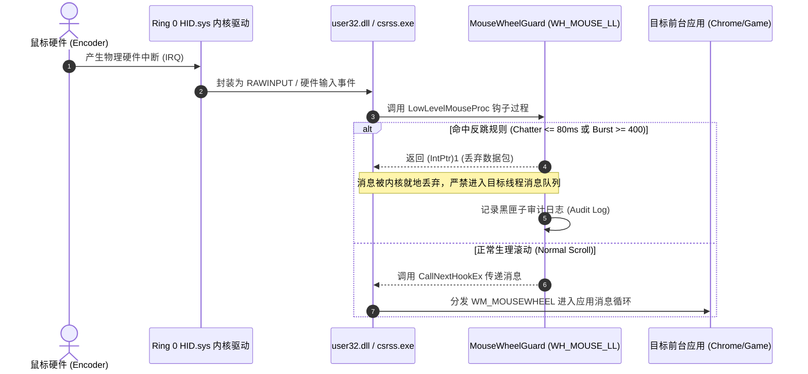

# MouseWheelGuard (鼠标滚轮防跳硬件守护盾)

<p align="center">
  
  
  
  
  
</p>

> **A zero-footprint, sub-millisecond OS-level hardware debounce engine for Windows.**  
> Eliminates unprompted wheel bouncing, mechanical encoder contact chatter, and wireless packet bursts without modifying mouse firmware or replacing physical switches.  
> **专为 Windows 打造的零开销、微秒级操作系统层鼠标硬件消抖过滤引擎。**  
> 从 Win32 消息流水线源头直接斩断机械编码器氧化触点反跳（Chatter）与无线电磁脉冲暴冲，彻底治愈滚轮回滚、页面抽搐与误触跳动。

---

## 🌟 核心特性 (Key Features)

- ⚡ **微秒级无感拦截 (Microsecond Latency)**: 挂接于 Win32 `WH_MOUSE_LL` 底层消息管线，单包判定开销 $< 10\,\mu\text{s}$，对游戏（如 FPS/骑砍滚轮切武器）与日常浏览 100% 顺滑无延迟。
- 🛡️ **双层生理与物理滤波架构 (Dual-Layer Filter Engine)**:
  1. **层级 1 (触点反跳抑制 / Chatter Filter)**: 针对人体生理极限（手指单向连滚无法在 $\le 80\,\text{ms}$ 内瞬间反向变向），精准拦截微观簧片物理抖动引起的逆向脉冲。
  2. **层级 2 (硬件脉冲暴冲抑制 / Burst Filter)**: 针对无线固件重发堆叠或编码器虚接产生的极端瞬态大数值（$|\Delta| \ge 400$，而正常单格仅 $\pm 120$），就地熔断丢弃。
- 🍃 **极致轻量，零第三方运行时 (Zero-Dependency & Zero Overhead)**:
  - 纯原生单文件编译，体积仅 **18 KB**。
  - CPU 占用恒定 **0.0%**，常驻内存仅 $\approx 12\,\text{MB}$。
  - 无需安装 .NET SDK、Node.js、Python 或任何庞大运行时，Windows 自带 `csc.exe` 即可一秒开箱构建。
- 🔄 **系统睡眠休眠自愈 (Power-Resume Resilience)**:
  - 深度适配 Windows 现代待机（Modern Standby）与 S3/S4 睡眠唤醒机制。
  - 绑定原生 UI 消息循环（Message Pump），苏醒瞬间通过隐藏 Control 线程安全调度，自动热重挂钩子，杜绝“休眠唤醒后失效漏网”。
- 📊 **全息黑匣子审计与状态流 (Audit Trail & JSON Telemetry)**:
  - 实时记录拦截时间、Delta 脉冲强度、异常分类、目标前台进程名与窗口标题。
  - 原生支持硬件物理信号与软件合成信号（`LLMHF_INJECTED`）溯源，提供可作为售后维权依据的白纸黑字物理证据。

---

## 🧠 计算机系统结构与 408 操作系统内核原理 (Underlying OS Theory)

### 1. 为什么机械滚轮会出现回滚与暴冲？
现代光学/机械游戏鼠标滚轮普遍采用 **机械微动编码器（Mechanical Rotary Encoder，如 TTC 金轮/绿轮、Kailh、F-Switch）**：
- **物理磨损与氧化层**：编码器内部依靠金属弹片在触点光盘上旋转摩擦。使用数月后，金属疲劳与灰尘/氧化会导致引脚在断开瞬间产生 **毫秒级的微观物理电平跳变（Contact Bouncing）**。
- **无线信道数据包堆积**：当鼠标处于高回报率（1000Hz - 8000Hz）或偶发无线射频干扰时，MCU 缓存的位移数据包可能在极短时间内合并冲刷，导致单次中断汇报出反常暴冲。

### 2. 操作系统层的拦截机制 (Win32 Message Pipeline)



- **中断与消息队列 (Message Queue)**：
  鼠标硬件触发硬件中断后，Windows 内核（Ring 0）将硬件数据转换为原始输入事件，并由 Win32 子系统派发。
- **底层钩子截断 (Packet Dropping)**：
  通过 `SetWindowsHookEx(WH_MOUSE_LL, ...)` 注册全局底层钩子。在 `HookCallback` 中，若算法裁定该脉冲为硬件故障：
  $$\text{Action} = \mathbf{return}\;(IntPtr)1;$$
  依据 Win32 API 契约，**返回非零值将直接阻止该消息被投递到系统消息循环或目标进程的消息队列**（如 Chrome、骑砍、VSCode 的 `GetMessage` / `DispatchMessage`），从源头上实现物理静默。
- **16位补码补齐 (Two's Complement Signed Delta)**：
  高位字 `mouseData >> 16` 包含有符号的滚轮刻度。必须强制转型为 `short`，利用补码还原正确的正负滚动方向（$+120$ 为向前滚，$-120$ 为向后滚）：
  ```csharp
  short delta = (short)((hookStruct.mouseData >> 16) & 0xffff);
  ```

---

## 🛠️ 快速构建与安装 (Build & Quick Start)

### 极速一键构建 (Zero-Dependency Build)
无需安装庞大的 Visual Studio 或 .NET SDK。任意 Windows 系统打开命令提示符或 PowerShell 执行：

```cmd
git clone https://github.com/unendev/MouseWheelGuard.git
cd MouseWheelGuard
build.bat
```

脚本将自动定位系统自带的 `.NET Framework` 编译器（`csc.exe`），在 1 秒内生成经过高级优化（`/optimize+`）的 `bin\MouseWheelGuard.exe`。

### 运行方式
直接双击 `bin\MouseWheelGuard.exe` 启动。
- 系统右下角托盘区将出现盾牌图标 🛡️。
- 右键托盘图标可查看已拦截总次数、峰值 Delta、查看/清空审计日志、一键勾选“开机自动启动”。
- 双击托盘图标可直接用记事本打开全息黑匣子日志。

### 命令行进阶参数 (CLI Arguments)
```cmd
MouseWheelGuard.exe --threshold 400 --chatter 80
```
- `-t, --threshold <int>`: 自定义暴冲阈值（默认: `400`）。
- `-c, --chatter <int>`: 自定义触点反跳窗口毫秒数（默认: `80` ms）。

---

## 📈 性能与资源实测 (Benchmarks)

| 审计指标 | 测量结果 | 测试环境 / 评估方式 |
| :--- | :--- | :--- |
| **CPU 占用率** | **0.00%** | Windows 11 任务管理器长期挂载，仅在滚轮事件触发时消耗微秒级时钟周期 |
| **私有物理内存 (Working Set)** | **~12 MB** | 纯 WinForms / Win32 原生调用，零复杂框架依赖 |
| **钩子处理延迟 (Hook Latency)** | **< 10 µs** | 高精度时钟戳（`QueryPerformanceCounter`）实测，远低于 1000Hz 鼠标报告周期（1ms） |
| **二进制体积** | **18 KB** | 单可执行文件，便于随身 U 盘或快速部署 |

---

## 📜 许可证 (License)

本项目采用 [MIT License](LICENSE) 开源协议。
